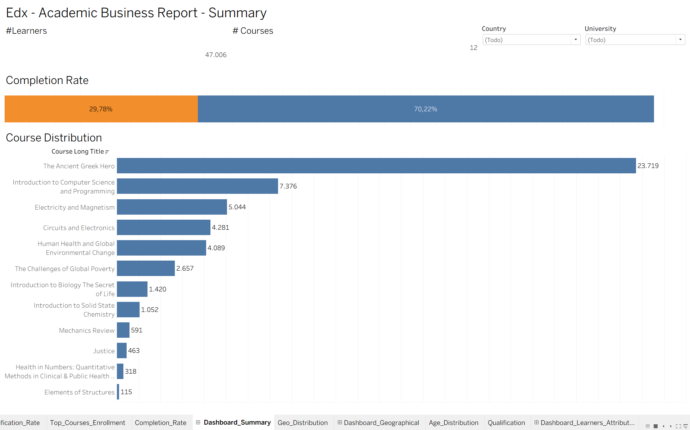
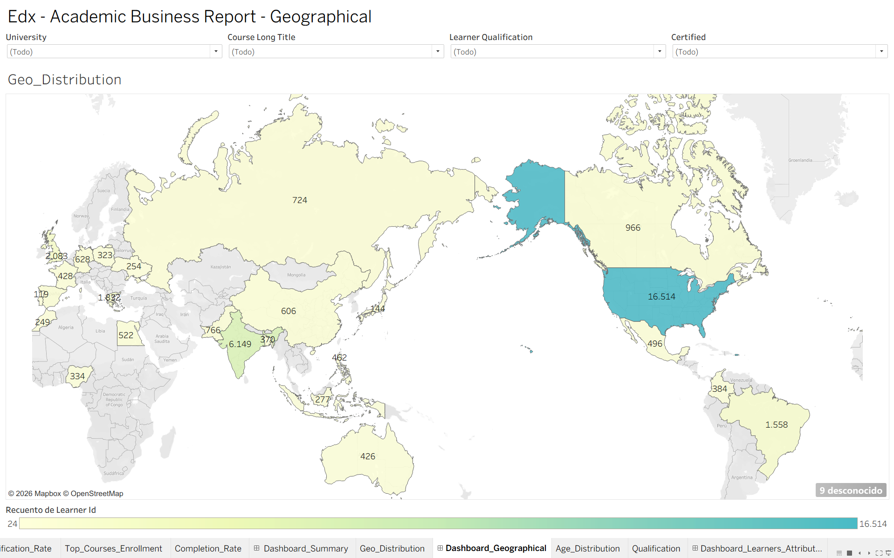
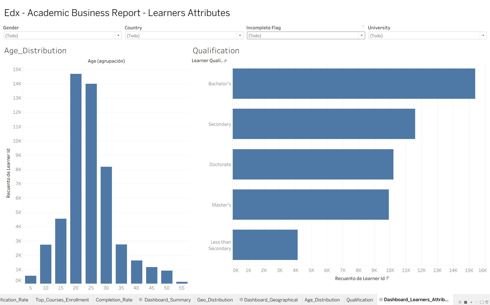

# EdX Academic Report 2012-13 — Tableau Dashboards

Interactive 3-dashboard analysis of EdX's platform data for 
academic year 2012-13, built as part of the Postgraduate Program 
in Data Science & Applied Generative AI at UT Austin McCombs.

## Business Context
EdX (Harvard + MIT online learning platform) needed a strategic 
analysis of their 2012-13 academic year to inform decisions for 
the following year.

## Dataset
- 51,231 learner-course records
- 19 fields: course info, learner demographics, outcomes, engagement
- Note: Dataset proprietary to Great Learning — not included in this repo

## Dashboards

### 1. Summary Dashboard

Key insights:
- 47,006 unique learners across 12 courses
- 70.22% completion rate (vs ~10% MOOC industry benchmark)
- The Ancient Greek Hero drove 50% of all enrollments

### 2. Geographical Dashboard

Key insights:
- USA dominant: 16,514 learners (35% of total)
- India second: 6,149 learners
- Growth opportunity: Latin America, Africa, Southeast Asia

### 3. Learners Attributes Dashboard

Key insights:
- Peak age range: 20-30 years
- 70% hold Bachelor's degree or higher
- 40% have Master's or Doctorate → highly educated audience

## Tools Used
- Tableau Desktop (data visualization, dashboards)
- Business storytelling framework

## Skills Demonstrated
- Multi-dashboard storytelling
- Calculated fields (IF/ELSE logic)
- Geographic data visualization (world maps)
- Interactive filters with scope control
- Z-pattern dashboard design
- Data aggregation (COUNTD, SUM, Quick Table Calculations)

## Author
Juan David Valderrama  
[LinkedIn](https://linkedin.com/in/juan-david-valderrama-valencia) | 
[GitHub](https://github.com/juandvalderrama)
